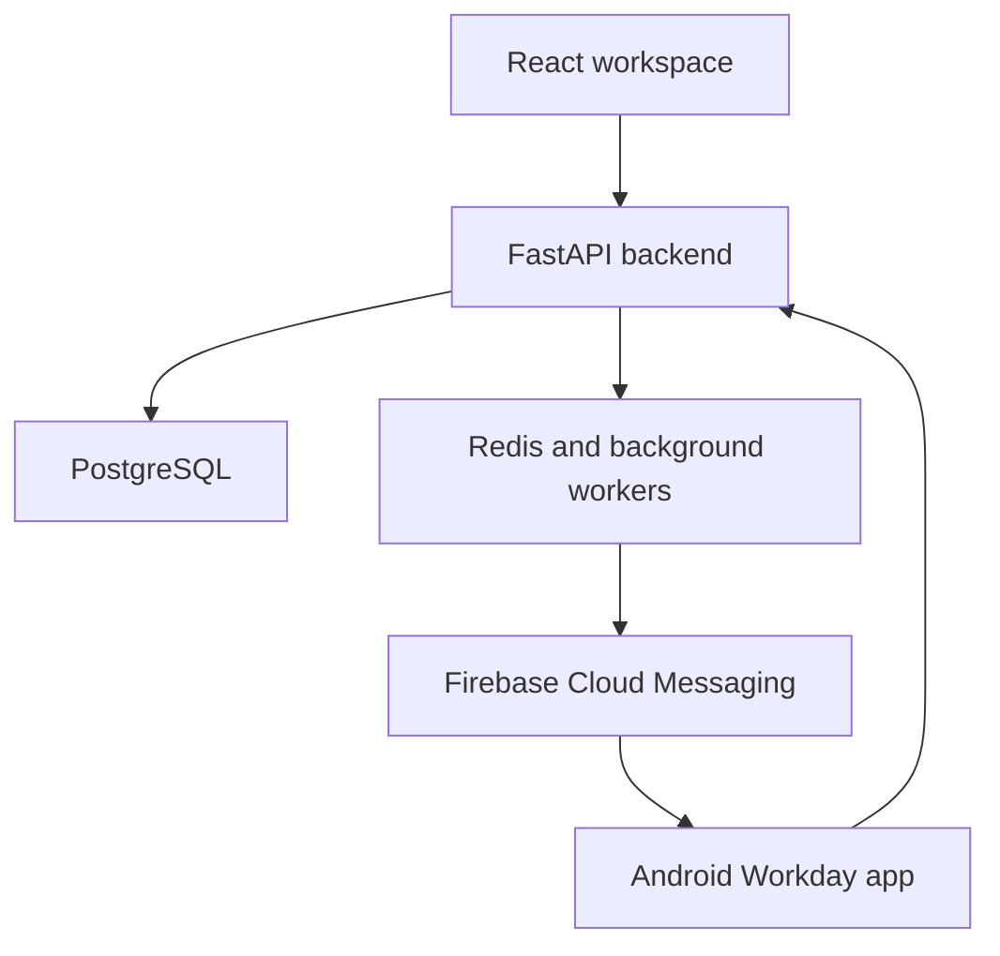

# SandS Workforce

A workforce and business operations platform with a React web workspace, a FastAPI backend, and a native Android companion app.

The project brings attendance, work-session location tracking, task assignment, payroll preparation and management approvals into one organisation-scoped system. It also handles shop inspections, vendors, rentals, deposits and loading expenses.

## Main features

| Area | Capabilities |
| --- | --- |
| Organisations and access | Organisation codes, user accounts, role-based access and organisation-scoped records |
| Attendance | Employee and vendor check-in/check-out, attendance history, date filters, work locations and geofence checks |
| Android workday | Native check-in flow, foreground location service during verified work sessions, local sample queue and an embedded HTTPS workspace |
| Notifications | In-app alerts and Firebase Cloud Messaging integration for Android notifications |
| Tasks | Assignments, due dates, progress reporting and management visibility |
| Payroll | Employee and vendor salary structures, allowances, deductions, salary advances, approval and export workflows |
| Shop operations | Outlet/vendor management, shop inspections, supporting documents and inspection review |
| Finance and assets | Expense requests, rentals, deposits, vehicles, fuel records and document records |
| Box Loading | Own/rented vehicles, calculated loading/transport costs, MD approval and payment recording |

## Technology

| Layer | Stack |
| --- | --- |
| Web | React, Vite, React Router |
| API | Python, FastAPI, Pydantic |
| Persistence | PostgreSQL, SQLAlchemy, Alembic |
| Supporting services | Redis, background workers, Firebase Admin SDK |
| Android | Java, Android SDK, Gradle, Firebase Cloud Messaging |
| File storage | AWS S3 integration |
| Hosting | AWS Lightsail, Ubuntu, Caddy HTTPS reverse proxy, systemd |

The Android app targets Android 8.0/API 26 and later. Location sampling and notification delivery depend on permissions, network access, the installed WebView, and Android/OEM background restrictions.

## Architecture

The web workspace and Android app share the same authenticated API. The backend owns attendance state, organisation scope, workflow permissions and financial calculations. Android verifies the work session before collecting location samples; checkout ends tracking.

## Example: Box Loading approval

1. Admin records the date, vehicle number and own/rented vehicle type.
2. Loading cost is the loading rate per box multiplied by boxes loaded.
3. Rented vehicles add transport cost, calculated from a separate rate and box count.
4. Admin reviews the calculated total and submits the request to MD.
5. MD approves or rejects it. Submitted and approved costs are locked.
6. After approval, Admin records the completed disbursement and payment reference.

The backend calculates the amounts using decimal arithmetic, checks the request version, and locks the row during transitions. The history retains the amounts and actor for each step. Payment recording does not initiate a bank or UPI transfer.

## Repository layout

- `backend/` — API source, models, services and migrations.
- `frontend/` — React workspace and frontend configuration.
- `android/` — Android Workday source, tests and Gradle wrapper.
- `docs/` — Architecture, configuration and project notes.

## Running your own instance

See [configuration notes](docs/CONFIGURATION.md), the Android [build guide](android/README.md), and [source snapshot notes](docs/SOURCE_SNAPSHOT.md).

The expected development tools are Python 3.12, PostgreSQL 16, Redis 7, Node.js 22, and JDK 21 with Android SDK 36. Use the committed dependency files and Gradle wrapper. Configure new local credentials and a separate database before running migrations or bootstrap scripts.

Firebase client configuration, server credentials, JWT signing secrets, database passwords and Android signing keys are provided outside version control. There are no shared demo login credentials in this repository.

## Engineering focus

- Shared API with native Android attendance and web-based business workspaces.
- Role- and organisation-aware reads and workflow actions.
- Server-side validation and approval gates for financial records.
- Clear submission states, retry handling and action history.
- Responsive forms and notification panels for smaller screens.
- Source updates with preflight checks, backups and service-readiness checks.

## Latest updates

See [updates through 24 October 2026](docs/UPDATES_2026_10_24.md) for the integrated workforce, cashier, attendance, financial download and payroll changes, setup requirements and validation.

## Project status

This is an actively developed operations application and a source-code portfolio. It is not a claim of an independent security audit or universal Android device certification. Fresh-environment migration setup, physical-device behaviour and configured cloud integrations should be validated for each deployment.

For the original source snapshot, all 199 backend Python files passed syntax checks and the frontend production build completed from the committed npm lockfile. The frontend build reports a large-bundle warning; route-based code splitting is a future improvement. See the snapshot notes for validation scope.

The public repository backs up application source. Operational databases, uploaded documents, employee/bank details, location history, credentials, logs and private deployment backups are maintained separately.

## Third-party software

Dependency licences remain with their respective authors. The Android map assets include the Leaflet licence alongside the bundled files. Publishing this repository does not change those licences.
